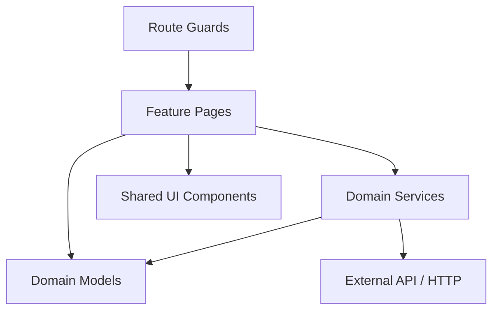

<!-- SpecDriven:managed:start -->
# Architecture Overview

## High-Level Architecture
This application is an Angular 20+ standalone application following a domain-driven architectural approach. It organizes code physically by feature sub-domains while sharing generic UI constructs in a central location.

## Dependency and System Boundaries

## Vocabulário: curso, módulo e o banco

A plataforma usa **curso** (HTML, Python, SQL) e **módulo** (etapa dentro de um curso). O banco mantém os nomes antigos, então a correspondência é:

| Vocabulário atual | Tabela / coluna no banco |
|---|---|
| Curso | `modules`, `user_modules`, `teacher_modules`, `module_id` |
| Módulo | `submodules`, `user_submodules`, `lessons.sub_module_id` |

Os services (`CourseService`, `ModuleService`) fazem a tradução. As edge functions `complete-quiz` e `evaluate-challenge` também mantêm os nomes antigos na resposta (`subModuleCompleted` = módulo concluído, `moduleCompleted` = curso concluído), e o front converte em `QuizService` e `UserLessonService`.

## Domains
The core bounded contexts align with user activities:
- `auth`: Login, registration, permissions
- `app`: Main authenticated shell and features (campaigns, rankings, achievements)

Everything is strictly modular at the folder level, using `standalone` components rather than `NgCourses` to compose tree structures dynamically.
<!-- SpecDriven:managed:end -->
